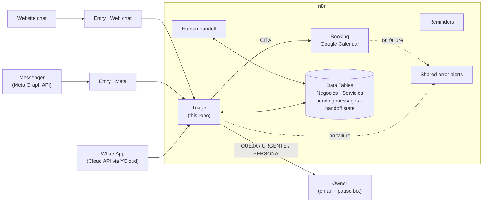
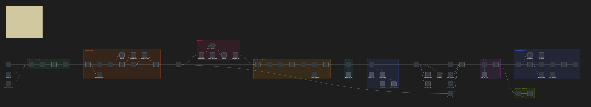

# WhatsApp AI Assistant on n8n

This is a modular AI customer-service system for **appointment-based businesses** (clinics, salons, studios). It answers customers on **WhatsApp, Messenger and web chat** (Instagram in progress) in Spanish or English, books appointments, hands the conversation to a human when needed, and alerts the owner when something breaks.

I designed and built it for my automation practice, [Lemus Automations](https://lemusautomations.com). It runs as a working demo on a real WhatsApp number, and you can try the web version on the site. This repo is a **public showcase**:

- the architecture
- the main workflow (sanitized)
- the Python tools I wrote around n8n

The production prompts, client configuration and the other workflows stay private.

> Node names and comments are in Spanish, because the product is built for businesses in Mexico.

## Architecture



| Workflow | What it does |
|---|---|
| **Triage** ("Primera Respuesta") | Understands every incoming message, classifies it and replies on the same channel. Sanitized export in [`workflows/triage.json`](workflows/triage.json). |
| **Booking** ("Agenda Llena") | Books, cancels and reschedules in Google Calendar, and offers 2–3 open alternatives when the requested time is taken. |
| **Human handoff** | When the owner replies from the WhatsApp app, the assistant pauses for that conversation and resumes on its own after a few hours, or with a keyword. |
| **Reminders** ("Cero Faltas") | Appointment reminders. *In progress:* each client needs its own Meta-approved Utility template. |
| **Error alerts** | One shared error workflow sends an email alert whenever any flow fails. |

## The Triage workflow

63 nodes, organized in labeled groups from left to right:



1. **Business configuration.** Loads the business profile and its service catalog from n8n Data Tables, and fails loudly if a required field is missing. One workflow serves many businesses: each one is a row, not a copy of the code.
2. **Input filters.** Drops messages meant for another number, respects the human-handoff pause, and supports a "night mode" where the team answers during business hours and the bot answers after hours. It also marks the message as read and shows "typing…".
3. **Voice notes.** Downloads the audio and transcribes it with Groq (Whisper), giving the model the business name as context.
4. **Message bursts.** People send three short messages instead of one. Every message is saved, the workflow waits for the customer to stop typing, and only the **last** execution answers, with all messages merged **in the order they arrived** (a voice note can finish transcribing after a later text).
5. **History + classification.** Claude reads the recent conversation (8-turn memory) and returns **strict JSON**, enforced by a structured output parser. A second auto-fixing parser repairs malformed output.
6. **Routing by category.** Appointments go to the booking workflow. Complaints, urgent cases and requests for a person go to the owner. Questions get answered directly. Unknown categories trigger an alert instead of failing silently.
7. **Reply.** The reply is sent on the same channel with a typing delay proportional to its length, so it feels human.

### Output schema

The model must answer in this shape, and nothing else:

```json
{
  "categoria": "CITA | CONSULTA | QUEJA | URGENTE | NO_RELACIONADO | PERSONA",
  "idioma": "es | en",
  "respuesta_cliente": "ready-to-send reply in the customer's language (10–500 chars)",
  "pregunta_para_negocio": "a question the assistant couldn't answer from the business data, for the owner; empty otherwise"
}
```

`pregunta_para_negocio` means the assistant never makes up an answer. If the information isn't in the business profile, it tells the customer it will check, and the owner gets an email with the exact question.

## Design decisions

- **Configuration in data, not in code.** Hours, services, prices, FAQs and the owner's email live in Data Tables. A new business means a new row, not a new workflow.
- **Per-client cost isolation.** Each client gets their own Anthropic workspace and API key, and their own BSP account, so usage and billing never mix.
- **Fail loudly.** Missing configuration, unexpected categories and node errors all reach the owner by email.
- **Cheap, fast model for triage.** Classification and replies run on Claude Haiku. The JSON schema keeps its output predictable.

## Tools

Python scripts I wrote to work with n8n through its REST API (standard library only):

- [`tools/n8n_acomodar.py`](tools/n8n_acomodar.py) is an **automatic layout** for n8n workflows.
  - It places nodes left to right by longest path, so arrows never point backwards.
  - It keeps the branches of IF and Switch nodes from crossing, and puts AI sub-nodes (model, memory, parser) under their parent.
  - It reports crossings and overlaps, and renders a preview. The workflow map above comes from it.
- [`tools/n8n_api.py`](tools/n8n_api.py) is a minimal API client: back up, inspect, create, update and activate workflows.

On top of these, a private script clones the whole stack (triage, booking, web-chat entry, reminders) for a new business from shared configuration. Five branded demos (dental clinic, beauty salon, nail studio, tattoo studio, barbershop) were generated that way.

## Stack

n8n (Cloud) · Claude API (Haiku) · WhatsApp Business Cloud API via YCloud (with Coexistence) · Meta Graph API · Google Calendar · Gmail · Groq Whisper · n8n Data Tables · Python

## How it was built

I designed the flows and wrote the specs. I built and debugged them in n8n with **Claude Code** connected to n8n through MCP, and wrote the Python tooling the same way.

---

**Diego Lemus Reyna**, AI Automation Specialist · [lemusautomations.com](https://lemusautomations.com) · diego.lemusre@gmail.com
